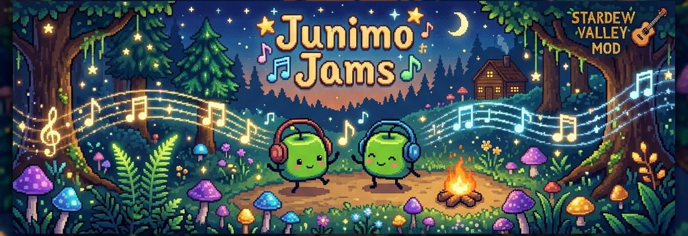

# 🌿 Junimo Jams (RustedUI Edition)



**A Blazing-Fast, Zero-GC Universal Music HUD & Player Hub for Stardew Valley 1.6+ (SMAPI 4.1+) Powered by [RustedUI](../Rusted)**

[](#)
[](#)
[](#)
[](#)
[](#)

---

## ✨ Overview

**Junimo Jams (RustedUI Edition)** is a complete reimagining of the beloved music overlay mod for **Stardew Valley 1.6+**. By replacing manual coordinates, per-pixel CPU buffering, and garbage-collected string rendering with **[RustedUI](../Rusted)** (Rust `SlotMap` arena, `Taffy v0.7` Flexbox/Grid, and Tailwind CSS), Junimo Jams renders its HUD overlay with **0 bytes of C# garbage collection per frame** and **~0.03–0.05 ms** render time.

It acts as a **Universal Media Hub** that tracks, controls, and displays details for almost any music player running on your machine: **Spotify**, **YouTube Music** (Chrome, Edge, Firefox, Brave, Safari, Arc), **Apple Music**, **TIDAL**, **Deezer**, **Cider**, **foobar2000**, **VLC**, and more.

---

## 🚀 Key Improvements with RustedUI

1. **🦀 Zero-GC Performance**:
   - Layout is computed natively in Rust via Taffy. Zero per-frame C# heap allocations mean smooth, jitter-free 60+ FPS gameplay with no GC pauses.
2. **🎨 10 Live Switchable Themes**:
   - Default: **Junimo Forest** (moss green, dewdrop cream, and organic woodland feel).
   - Instant live switching between **Pelican Classic**, **Shadcn Zinc Dark**, **Wizard Arcane**, **JojaCorp Blue**, **Catppuccin Mocha**, **Tokyo Night**, **Dracula**, **Nord Polar**, and **Cyberpunk Neon**.
   - **`FollowGlobal` Mode**: Option to dynamically inherit the player's globally selected RustedUI theme.
3. **🔥 Live `<20 ms` HTML Hot-Reload**:
   - Edit `assets/ui/music_hud.html` or `assets/ui/music_menu.html` while playing and watch your HUD update instantaneously!
4. **💬 Theme-Aware Floating Tooltips & Audio Feedback**:
   - Hovering over buttons and song titles renders crisp, floating tooltips styled with the active theme's design tokens.
   - Button clicks trigger authentic Stardew sound cues (`bigSelect`, `dwop`, `drumkit6`).
5. **🎛️ In-Game Music Hub Modal (`F6`)**:
   - Press **`F6`** (or click `Hub` on the HUD) to open a full in-game music control panel with playback buttons, live theme switcher, and track metadata.
6. **🖼️ Smart Cover Art Matching**:
   - Automatically resolves track names and artists using token-based Jaccard similarity against the iTunes API and caches 600x600 high-res cover arts locally in `cache/`.

---

## 🎮 Controls & Keybinds

| Keybind | Action | Description |
|---|---|---|
| **`F6`** | **Open / Close Music Hub** | Opens the interactive Junimo Jams Music Menu. |
| **`ESC`** | **Close Music Hub** | Closes the open music menu with vanilla sound effects. |
| **`Left Click`** | **Interactive Controls** | Click Play/Pause, Previous, Next, or the Hub button directly on the HUD overlay. |

---

## 🎧 Supported Music Players

| Category | Supported Players | Windows | macOS | Linux |
|---|---|:---:|:---:|:---:|
| **Streaming** | **Spotify**, **Apple Music / iTunes**, **Amazon Music** | ✅ | ✅ | ✅ |
| **YouTube Music** | Browser Tabs (Chrome, Edge, Firefox, Brave, Safari, Arc, Helium) | ✅ | ✅ | ✅ |
| **Desktop App** | Official YouTube Music Desktop App | ✅ | — | — |
| **High-Fidelity** | **TIDAL**, **Deezer**, **Cider**, **Plexamp** | ✅ | ✅ | ✅ |
| **Media Players** | **foobar2000**, **MusicBee**, **AIMP**, **Winamp**, **MediaMonkey**, **VLC** | ✅ | — | ✅ |
| **Custom** | Any custom process name specified in `ExtraPlayers` | ✅ | ✅ | ✅ |

---

## 🛠️ Building & Deploying

### Prerequisites
- **Stardew Valley 1.6+** with **SMAPI 4.1+**
- **RustedUI Mod (`Mehmetcan.RustedUI`)** installed in your Stardew Valley `Mods/` directory
- **.NET 6.0 SDK**

### Build Command
Run the build script to compile and deploy directly to your `Mods/JunimoJamsRusted` folder:

```bash
./build.sh
```

---

## 📁 Repository Structure

```text
JunimoJamsRusted/
├── build.sh                                     # One-command dotnet build and deploy script
├── JunimoJamsRusted.sln                         # Visual Studio solution
├── README.md                                    # Comprehensive documentation
└── JunimoJamsRusted/
    ├── JunimoJamsRusted.csproj                  # C# project with Rusted.Smapi reference
    ├── manifest.json                            # SMAPI manifest with Mehmetcan.RustedUI dependency
    ├── ModConfig.cs                             # Configuration schema
    ├── ModEntry.cs                              # SMAPI lifecycle, polling & event dispatching
    ├── IGenericModConfigMenuApi.cs              # Optional GMCM integration
    ├── assets/
    │   └── ui/
    │       ├── music_hud.html                   # Hot-reloadable HTML music HUD overlay
    │       └── music_menu.html                  # Hot-reloadable HTML Music Hub modal
    ├── Services/                                # Multi-platform media tracking & iTunes art matching
    │   ├── TrackInfo.cs
    │   ├── StringUtils.cs
    │   ├── IMusicPlayer.cs
    │   ├── MusicService.cs
    │   ├── ArtService.cs
    │   └── Platform/
    │       ├── LinuxMusicPlayer.cs              # D-Bus MPRIS2 tracker
    │       ├── WindowsMusicPlayer.cs            # Win32 EnumWindows & media keys
    │       ├── MacMusicPlayer.cs                # AppleScript & Quartz media keys
    │       └── YouTubeMusicParser.cs            # Universal browser title parser
    └── UI/                                      # RustedUI integration layer
        ├── RustedMusicHud.cs                    # RustedView HUD overlay manager
        └── RustedMusicMenu.cs                   # RustedMenu in-game Music Hub
```

---

## 📜 License

MIT License — Copyright (c) 2026 MehmetCanWT
